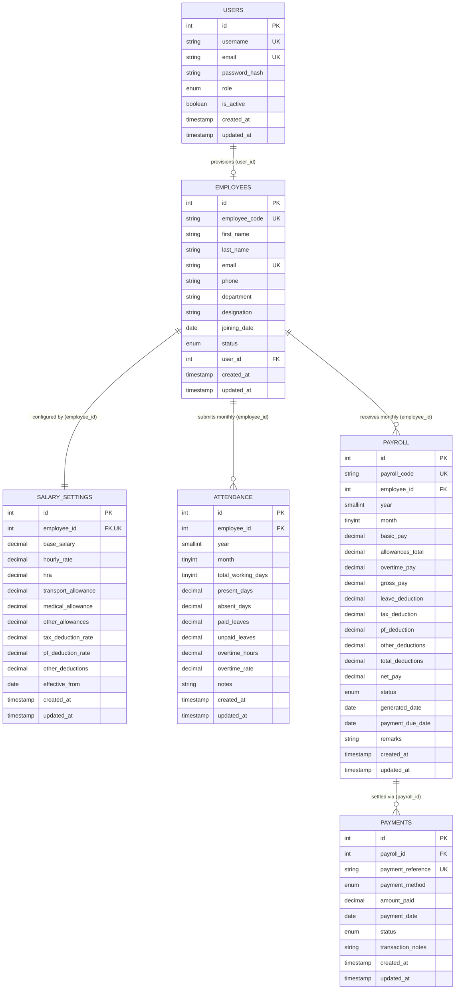

# Employee Payroll Management System

[](https://www.python.org/)
[](https://flask.palletsprojects.com/)
[](https://www.mysql.com/)
[](https://getbootstrap.com/)
[](https://docs.pytest.org/)

Enterprise-grade **Employee Payroll Management System** built with **Python Flask** and **MySQL Server 8.0**. Designed under strict database normalization principles (3NF), relational referential integrity, and atomic ACID transaction guarantees.

---

## Architectural Milestones

### Module 1: Architecture & Foundation
* **Application Factory Pattern**: `create_app()` in [`app.py`](file:///d:/PayRoll/app.py) supporting `development`, `testing`, and `production` configurations.
* **ACID Relational Schema (`schema.sql`)**: 6 normalized tables (`users`, `employees`, `attendance`, `salary_settings`, `payroll`, `payments`) using `InnoDB`, `DECIMAL(12,2)`, and `ON DELETE RESTRICT` for historical preservation.
* **Connection Pooling & Transactions (`repositories/db.py`)**: `mysql.connector.pooling` with auto-rollback transaction context managers.

### Module 2: Finance Manager Authentication & Dashboard
* **Authentication Service (`modules/auth/`)**:
  * Secure credential verification against the MySQL `users` table.
  * Werkzeug password hashing (Scrypt / PBKDF2) &mdash; zero plaintext storage.
  * Session-based authentication with session fixation protection.
  * `@login_required` route protection decorator.
  * Robust, cryptographically secure CSRF protection across all state-modifying requests (`utils/csrf.py`).
  * Safe CLI command `flask create-user` and standalone script `create_user.py` to create Finance Manager or Admin accounts without hardcoding credentials.
* **Finance Management Dashboard (`modules/dashboard/`)**:
  * Active employee count (`SELECT COUNT(*) FROM employees WHERE status = 'ACTIVE'`).
  * Dynamic month and year period filter.
  * Parameterized financial aggregations: Total Gross Payroll, Total Deductions, and Net Salary Paid (`status = 'PAID'`).
  * Awaiting processing indicator banner (`status IN ('DRAFT', 'GENERATED')`).
  * Interactive monthly trends chart powered by **Chart.js** (Gross vs Net Pay).
  * Recent payroll activity table with status badges and employee info.
  * Resilient empty-database handling: gracefully defaults to `₹0.00`, 0 counts, and empty states without throwing exceptions.

### Module 3: Employee Management
* **Employee Directory & Pagination (`modules/employees/`)**:
  * Paginated table listing with configurable per-page slicing and total count badges.
  * Real-time search across Employee Code, First Name, Last Name, Full Name, Email, and Department.
  * Status filtering (`ALL`, `ACTIVE`, `INACTIVE`) and Department dropdown filtering.
* **Atomic Employee Creation**:
  * Server-side validation of all fields (email regex, required strings, valid dates).
  * Auto-generation of sequential employee codes (`EMP001`, `EMP002`, etc.) if omitted.
  * Rejection of negative or non-numeric salaries.
  * Prevention of duplicate employee codes and emails.
  * Atomic multi-table database transaction: creates record in `employees` and simultaneously initializes `salary_settings` with `base_salary`.
* **Profile Management & Audit Safeguards**:
  * Detailed profile view ([`templates/employees/view.html`](file:///d:/PayRoll/templates/employees/view.html)) displaying organizational, contact, and compensation data.
  * Editing capability for profile details and salary structures with transaction integrity.
  * **Safe Deactivation / Reactivation**: Transitions employee status to `INACTIVE` while preserving 100% of historical payroll and payment disbursements.
  * **Historical Protection**: Permanent deletion is strictly blocked when foreign-key historical attendance or payroll records exist (`ON DELETE RESTRICT`).

### Module 4: Attendance & Leave Management
* **Reconciliation Ledger & History (`modules/attendance/`)**:
  * Monthly attendance recording with working days, days worked, leaves, and overtime.
  * Single monthly summary enforcement per employee (`uq_attendance_employee_month_year`).
  * Excess leave rejection: sum of days worked and leaves cannot exceed total working days.
  * Distinct leave categories: Paid leaves (0 deduction) vs. Unpaid leaves (LWP).
  * Weekend & holiday working day rule: excludes Saturdays and Sundays (standard 5-day week baseline).
  * Employee-specific historical attendance ledger ([`templates/attendance/employee_history.html`](file:///d:/PayRoll/templates/attendance/employee_history.html)).

### Module 5: Salary Configuration & Salary Calculation Service
* **Reusable Calculation Service (`modules/salary/services.py`)**:
  * Strict `Decimal` precision for all financial operations &mdash; zero binary floating-point arithmetic.
  * Consistent `ROUND_HALF_UP` rounding policy to two decimal places.
  * Mathematical rules:
    * `Daily salary = Basic monthly salary / Total working days in payroll month`
    * `Leave deduction = Daily salary * Unpaid leave days` (paid leave days strictly incur 0 deduction)
    * `Overtime payment = Overtime hours * Overtime rate` (employee-specific rate takes precedence)
    * `Gross salary = Basic salary + Allowances + Overtime payment`
    * `Total deductions = Leave deduction + Other deductions`
    * `Net salary = Gross salary - Total deductions`
  * Zero and negative working days rejection (`ZeroWorkingDaysError`).
  * Missing input rejection without silent defaults (`MissingSalaryInputError`).
  * Deductions capped at gross salary unless negative net pay is explicitly configured (`DeductionExceedsGrossError`).
* **Salary Preview Engine (`/salary/preview`)**:
  * Finance Manager interactive calculation preview powered by actual MySQL employee and attendance records.
  * Itemized breakdown of earnings, daily salary rate, unpaid leave deduction, overtime payment, and net take-home salary.
  * Automatic missing-attendance detection with one-click redirection to record monthly attendance.

### Module 6: Monthly Payroll Processing & Batch Runs
* **Batch and Individual Payroll Processing (`modules/payroll/`)**:
  * Reusable `PayrollService` strictly delegating all salary calculations to `SalaryCalculationEngine` in `modules/salary/services.py` &mdash; zero duplicated formulas.
* **Controlled Monthly Batch Run (`/payroll/run`)**:
  * Comprehensive workforce audit classifying each active employee as eligible or ineligible (missing attendance, unconfigured salary, or pre-existing payroll).
  * Transactional batch generation with isolated failure handling &mdash; skips invalid records without corrupting eligible runs.
* **Single Employee Payroll Generator (`/payroll/generate`)**:
  * Interactive preview calculating base salary, working days, daily salary rate, allowances, overtime pay, leave deduction, and net take-home salary in INR (₹).
  * Strict validation preventing duplicate monthly generation (`uq_payroll_employee_month_year`).
* **Status Lifecycle & Concurrency Safeguards**:
  * Status transitions: `DRAFT` &rarr; `APPROVED`, `DRAFT` &rarr; `CANCELLED`, `APPROVED` &rarr; `DRAFT` (mandatory correction reason).
  * Optimistic concurrency locking (`expected_current_status`) protecting against concurrent modifications.
  * Protected `PAID` state &mdash; disbursements are strictly locked against modification or cancellation.
  * Guard against direct `PAID` transition in Module 6 (reserved for Module 7 Payment Processing).
* **Salary Snapshot Preservation**:
  * Finalized/approved payroll records freeze salary components (`basic_pay`, `allowances_total`, `overtime_pay`, `gross_pay`, `leave_deduction`, `net_pay`). Subsequent updates to employee salary settings or base salaries never alter historical statements.
* **Detailed Payslip Statement (`/payroll/<id>`)**:
  * Two-column breakdown of earnings and deductions in INR (`₹{:,.2f}`).
  * Attendance reconciliation box linking days worked, leaves, and overtime hours.
  * Print styles (`@media print`) for clean physical or PDF payslip printing.

### Module 7: Payment Management & Salary Slips
* **Academic Simulation Application**:
  * Designates that all disbursements are educational simulation records &mdash; zero real money is transferred.
* **Approved Payroll Queue (`/payments/awaiting`)**:
  * Displays all approved payroll statements awaiting disbursement with net payable amounts in INR (`₹`).
  * Only records in `APPROVED` status can be disbursed. Statements in `DRAFT`, `CANCELLED`, or already `PAID` are strictly ineligible.
* **Disbursement Voucher Recording (`/payments/record/<id>`)**:
  * Auto-generates unique, standardized transaction references (`TXN-{YYYYMM}-{EMP}-{HEX}`).
  * Pre-fills and validates exact net pay amounts &mdash; prevents invalid, zero, or negative amounts.
  * Selectable payment instruments: `BANK_TRANSFER`, `CHEQUE`, `CASH`, `UPI`, `DIRECT_DEPOSIT`.
  * ACID database transaction synchronization:
    * Recording a `SUCCESSFUL` payment updates the payment voucher and marks linked payroll status as `PAID`.
    * A `FAILED` or `PENDING` payment records the transaction attempt without marking payroll as `PAID`.
    * Repeated payment attempts on an already paid statement are rejected.
* **Disbursement Ledger & History (`/payments`)**:
  * Search by transaction reference, employee name, employee code, or department.
  * Multi-dimensional filtering by month, year, status (`SUCCESSFUL`, `PENDING`, `FAILED`, `REVERSED`), and payment method.
  * Financial KPI cards displaying total disbursed, successful count, pending authorization, and reversals in INR (`₹`).
* **Controlled Status Reversals & Corrections**:
  * Reversing a payment (`SUCCESSFUL` &rarr; `REVERSED`) mandates an explicit audit reason and rolls back the associated payroll record from `PAID` back to `APPROVED`.
* **Printable Salary Slips & ReportLab PDF Generation**:
  * **HTML Slip (`/payments/slip/<id>`)**: Print-friendly statement with `@media print` CSS hiding navigation chrome.
  * **PDF Slip Download (`/payments/slip/<id>/pdf`)**: Generates an official, publication-quality A4 PDF salary slip via ReportLab with corporate branding, watermark, employee profile, attendance summary, itemized earnings vs. deductions in INR (`₹`), net salary banner, payment confirmation details, and authorization signatures.

### Module 8: Reports & DBMS Academic Documentation
* **Comprehensive Financial Reporting Portal (`/reports`)**:
  1. **Monthly Payroll Summary**: Aggregates gross salary commitments, total statutory deductions, and net take-home pay, alongside statement lifecycle counts.
  2. **Employee-Wise Salary History**: Chronological disbursement history filterable by employee, department, and calendar year with pagination.
  3. **Gross, Deductions & Net Salary Breakdown**: Granular analytical tables with SQL aggregation equations.
  4. **Attendance & Unpaid Leave Reconciliation**: Workforce working days, days worked, paid leaves, unpaid leaves (LWP), and overtime metrics.
  5. **Payroll Status & Payment Method Distribution**: Status counts (`DRAFT`, `APPROVED`, `PAID`, `CANCELLED`) and method volumes (`BANK_TRANSFER`, `CHEQUE`, `CASH`, `UPI`, `DIRECT_DEPOSIT`).
  6. **Department Workforce & Payroll Allocation**: Headcount, active/inactive ratios, base salary commitments, and compensation ranges per department.
  7. **Direct RFC-4180 CSV Data Exports**:
     * `/reports/export/payroll.csv`: Complete monthly payroll register.
     * `/reports/export/attendance.csv`: Monthly attendance reconciliation.
     * `/reports/export/payments.csv`: Detailed disbursement transaction ledger.
     * `/reports/export/departments.csv`: Department workforce and compensation summary.
* **Interactive DBMS Academic Documentation (`/reports/dbms`)**:
  * Full university-grade documentation page detailing relational schemas, normalization proofs, SQL query patterns, ACID guarantees, and comprehensive curriculum indexing.

*Confirmed and tested with 18 comprehensive unit and integration tests in [`tests/test_reports.py`](file:///d:/PayRoll/tests/test_reports.py).*

### Module 9: Full Integration, End-to-End Testing & System Finalization
* **Complete 15-Step End-to-End Operational Lifecycle**:
  1. **Provision Account**: Create Finance Manager with encrypted password via `flask create-user` or `create_user.py`.
  2. **Authenticate**: Session creation, role verification (`ACCOUNTANT`), and secure dashboard access.
  3. **Workforce Provisioning**: Atomic creation of employee profile + salary configuration transaction.
  4. **Directory Navigation**: Multi-parameter search, filtering, and transactional profile updating.
  5. **Attendance Reconciliation**: Monthly attendance ledger recording with weekend exclusion and leave rules.
  6. **Compensation Structuring**: Configuration of allowances (HRA, Transport, Medical) and overtime rates.
  7. **Interactive Preview Engine**: Mathematical verification ($R_D, D_L, P_{OT}, S_{\text{Gross}}, D_{\text{Total}}, S_{\text{Net}}$) with decimal precision.
  8. **Payroll Generation**: Single-employee and batch payroll generation with frozen historical salary snapshot.
  9. **Duplicate Prevention**: Rejection of duplicate generation for the same employee-month period (`uq_payroll_employee_month_year`).
  10. **Status Authorization**: Controlled transition from `DRAFT` to `APPROVED` with validation.
  11. **Disbursement Recording**: Payment recording with unique transaction references (`TXN-...`) and instrument selection.
  12. **Status Consistency**: Simultaneous transition of payment voucher to `SUCCESSFUL` and payroll to `PAID`.
  13. **Salary Slip Generation**: Dynamic HTML preview with `@media print` styling and publication-ready ReportLab PDF download.
  14. **Analytical Reports**: Multi-tab financial reports, SQL aggregations, and RFC-4180 CSV exports.
  15. **Session Invalidation & Access Control**: Secure logout and `@login_required` enforcement on all protected routes.
* **Hermetic Integration Test Suite (`tests/test_full_workflow.py`)**:
  * 16 dedicated end-to-end tests covering all 15 workflow steps individually plus a comprehensive holistic end-to-end lifecycle test.
  * 100% pass rate with zero dependency on pre-existing external database state.

---

## DBMS Academic Documentation

This section provides the formal relational database specification, schema models, normalization analysis, relational calculus, query patterns, and transaction architecture for academic evaluation.

### 1. Project Overview & System Objectives
* **Domain**: Enterprise Human Resource Management & Compensation Accounting.
* **Core Problem Addressed**: Manual and spreadsheet-based payroll processes suffer from duplicate records (ghost employees), arithmetic errors, duplicate monthly disbursements, and lack of historical audit trails.
* **Database Objectives**:
  * Establish strict referential integrity via Foreign Keys with `ON DELETE RESTRICT` to prevent accidental deletion of historical payroll audit trails.
  * Guarantee mathematical precision using fixed-point `DECIMAL(12,2)` arithmetic (eliminating binary IEEE-754 floating-point inaccuracies).
  * Prevent duplicate salary statements using composite unique constraints (`UNIQUE(employee_id, year, month)`).
  * Enforce ACID transaction boundaries (`START TRANSACTION / COMMIT / ROLLBACK`) across multi-table operations.

### 2. Entity-Relationship (ER) Diagram



### 3. Relational Schema Notation (Boyce-Codd Notation)
* **USERS** (<ins>id</ins>, username [UQ], email [UQ], password_hash, role, is_active, created_at, updated_at)
* **EMPLOYEES** (<ins>id</ins>, employee_code [UQ], first_name, last_name, email [UQ], phone, department, designation, joining_date, status, *user_id* [FK &rarr; USERS(id), UQ, NULLABLE], created_at, updated_at)
* **SALARY_SETTINGS** (<ins>id</ins>, *employee_id* [FK &rarr; EMPLOYEES(id), UQ], base_salary, hourly_rate, hra, transport_allowance, medical_allowance, other_allowances, tax_deduction_rate, pf_deduction_rate, other_deductions, effective_from, created_at, updated_at)
* **ATTENDANCE** (<ins>id</ins>, *employee_id* [FK &rarr; EMPLOYEES(id)], year, month, total_working_days, present_days, absent_days, paid_leaves, unpaid_leaves, overtime_hours, overtime_rate, notes, created_at, updated_at) &mdash; **Candidate Key:** `(employee_id, year, month)`
* **PAYROLL** (<ins>id</ins>, payroll_code [UQ], *employee_id* [FK &rarr; EMPLOYEES(id)], year, month, basic_pay, allowances_total, overtime_pay, gross_pay, leave_deduction, tax_deduction, pf_deduction, other_deductions, total_deductions, net_pay, status, generated_date, payment_due_date, remarks, created_at, updated_at) &mdash; **Candidate Key:** `(employee_id, year, month)`
* **PAYMENTS** (<ins>id</ins>, *payroll_id* [FK &rarr; PAYROLL(id)], payment_reference [UQ], payment_method, amount_paid, payment_date, status, transaction_notes, created_at, updated_at)

### 4. Cardinality & Referential Integrity

| Parent Table | Child Table | Cardinality | Foreign Key | ON DELETE | ON UPDATE | Referential Purpose |
| :--- | :--- | :---: | :--- | :---: | :---: | :--- |
| `employees` | `salary_settings` | **1 : 1** | `employee_id` | `RESTRICT` | `CASCADE` | Unique constraint enforces one compensation structure per employee. Master record cannot be deleted if active pay rules exist. |
| `employees` | `attendance` | **1 : N** | `employee_id` | `RESTRICT` | `CASCADE` | Preserves monthly timesheet logs against master employee deletion. |
| `employees` | `payroll` | **1 : N** | `employee_id` | `RESTRICT` | `CASCADE` | Unique composite `(employee_id, year, month)` enforces at most one slip per month. Prevents deletion of employees with pay history. |
| `payroll` | `payments` | **1 : N** | `payroll_id` | `RESTRICT` | `CASCADE` | Payment disbursements reference payroll statements. Prohibits deleting payroll ledgers that have payment audit records. |
| `users` | `employees` | **0/1 : 1** | `user_id` | `SET NULL` | `CASCADE` | De-provisioning a system authentication account retains the employee profile with nullified credentials. |

> **Significance of `ON DELETE RESTRICT`:** Under financial and statutory accounting rules (SOX, tax audit regulations), payroll ledgers and payment receipts must never be deleted cascade-style. Deleting an employee master record is rejected if historical records exist.

### 5. Normalization Analysis (1NF to 3NF)
1. **First Normal Form (1NF)**:
   * **Rule**: All column values are atomic (indivisible), no repeating groups, and each relation possesses an identified primary key.
   * **Proof**: Names are decomposed into `first_name` and `last_name`. Allowances are stored as individual numeric columns (`hra`, `transport_allowance`, `medical_allowance`) rather than delimited text or JSON arrays. Every table defines an explicit integer `AUTO_INCREMENT` primary key.
2. **Second Normal Form (2NF)**:
   * **Rule**: In 1NF and every non-prime attribute is fully functionally dependent on the relation's candidate keys (no partial dependencies).
   * **Proof**: In `attendance` and `payroll`, composite candidate keys exist: `(employee_id, year, month)`. Non-key attributes like `present_days`, `unpaid_leaves`, `overtime_pay`, and `leave_deduction` depend on the *entire* triplet &mdash; not solely on `employee_id` or `(year, month)`. Employee demographic data (`department`, `designation`) is isolated in `employees` rather than repeated in `payroll`.
3. **Third Normal Form (3NF)**:
   * **Rule**: In 2NF and no non-prime attribute is transitively dependent on the primary key ($X \rightarrow Y$ where $Y \rightarrow Z$).
   * **Proof**: In `employees`, designations and departments do not determine compensation amounts; compensation is isolated in `salary_settings`.
   * **Temporal Snapshotting Rationale**: In `payroll`, storing `basic_pay`, `allowances_total`, and `net_pay` preserves an immutable *temporal snapshot* of the financial statement at generation time. If an employee's salary increases next year, historical payroll records must not change. This is canonical temporal normalization in accounting databases, not a transitive dependency violation.

### 6. Parameterized CRUD Operations (SQL Examples)

#### SELECT (Detailed Payroll Statement with Employee Joins)
```sql
SELECT 
    p.id, p.payroll_code, p.year, p.month, p.gross_pay, p.total_deductions, p.net_pay, p.status,
    e.employee_code, CONCAT(e.first_name, ' ', e.last_name) AS employee_name,
    e.department, e.designation,
    s.base_salary, s.hra, s.transport_allowance, s.medical_allowance
FROM payroll p
INNER JOIN employees e ON p.employee_id = e.id
LEFT JOIN salary_settings s ON e.id = s.employee_id
WHERE p.id = %s;
```

#### INSERT (Monthly Attendance Record)
```sql
INSERT INTO attendance (
    employee_id, year, month, total_working_days, present_days, 
    absent_days, paid_leaves, unpaid_leaves, overtime_hours, overtime_rate, notes
) VALUES (
    %s, %s, %s, %s, %s, 
    %s, %s, %s, %s, %s, %s
);
```

#### UPDATE (Optimistic Concurrency State Transition)
```sql
UPDATE payroll 
SET status = %s, remarks = %s, updated_at = NOW()
WHERE id = %s AND status = %s;
```

#### DELETE / Soft Cancellation (Audit-Safe Status Invalidation)
```sql
-- Audit-safe employee deactivation
UPDATE employees SET status = 'INACTIVE', updated_at = NOW() WHERE id = %s;

-- Physical deletion permitted only on Draft statements (guaranteed 0 payments by FK)
DELETE FROM payroll WHERE id = %s AND status = 'DRAFT';
```

### 7. Multi-Table Analytical JOIN Queries

#### Analytical Query 1: Payroll Reconciliation Ledger with Payment Disbursements
```sql
SELECT 
    p.id AS payroll_id,
    p.payroll_code,
    CONCAT(e.first_name, ' ', e.last_name) AS employee_name,
    e.employee_code,
    e.department,
    p.net_pay,
    COALESCE(SUM(pm.amount_paid), 0.00) AS total_disbursed,
    (p.net_pay - COALESCE(SUM(pm.amount_paid), 0.00)) AS outstanding_balance,
    p.status AS payroll_status
FROM payroll p
INNER JOIN employees e ON p.employee_id = e.id
LEFT JOIN payments pm ON p.id = pm.payroll_id AND pm.status = 'SUCCESSFUL'
WHERE p.year = %s AND p.month = %s
GROUP BY p.id, p.payroll_code, e.first_name, e.last_name, e.employee_code, e.department, p.net_pay, p.status
ORDER BY e.department ASC, e.last_name ASC;
```

#### Analytical Query 2: Attendance-to-Payroll Leave Deduction Audit Join
```sql
SELECT 
    e.employee_code,
    CONCAT(e.first_name, ' ', e.last_name) AS employee_name,
    a.total_working_days,
    a.unpaid_leaves,
    p.basic_pay,
    ROUND((p.basic_pay / a.total_working_days) * a.unpaid_leaves, 2) AS expected_deduction,
    p.leave_deduction AS recorded_deduction,
    CASE 
        WHEN ROUND((p.basic_pay / a.total_working_days) * a.unpaid_leaves, 2) = p.leave_deduction THEN 'RECONCILED'
        ELSE 'VARIANCE_DETECTED'
    END AS audit_status
FROM payroll p
INNER JOIN employees e ON p.employee_id = e.id
INNER JOIN attendance a ON p.employee_id = a.employee_id AND p.year = a.year AND p.month = a.month
WHERE p.year = %s AND p.month = %s;
```

### 8. GROUP BY, Aggregations & Conditional Metrics

#### Department-Level Workforce & Payroll Allocation
```sql
SELECT 
    e.department,
    COUNT(e.id) AS total_employees,
    COUNT(CASE WHEN e.status = 'ACTIVE' THEN 1 END) AS active_employees,
    COALESCE(SUM(s.base_salary), 0.00) AS total_base_payroll,
    COALESCE(AVG(s.base_salary), 0.00) AS avg_base_salary,
    COALESCE(MIN(s.base_salary), 0.00) AS min_base_salary,
    COALESCE(MAX(s.base_salary), 0.00) AS max_base_salary
FROM employees e
LEFT JOIN salary_settings s ON e.id = s.employee_id
GROUP BY e.department
HAVING COUNT(e.id) > 0
ORDER BY total_base_payroll DESC;
```

#### Payment Method Volume Distribution
```sql
SELECT 
    pm.payment_method,
    COUNT(pm.id) AS transaction_count,
    COALESCE(SUM(pm.amount_paid), 0.00) AS total_amount,
    COALESCE(AVG(pm.amount_paid), 0.00) AS avg_transaction_size
FROM payments pm
WHERE pm.status = 'SUCCESSFUL'
GROUP BY pm.payment_method
ORDER BY total_amount DESC;
```

### 9. Monthly Salary Calculation Model & SQL Implementation
* **Daily Salary Rate**: $R_D = \frac{\text{Basic Salary}}{\text{Total Working Days}}$
* **Unpaid Leave Deduction**: $D_L = R_D \times \text{Unpaid Leaves}$
* **Overtime Payment**: $P_{OT} = \text{Overtime Hours} \times \text{Overtime Rate}$
* **Gross Salary**: $S_{\text{Gross}} = \text{Basic} + \text{Allowances} + P_{OT}$
* **Total Deductions**: $D_{\text{Total}} = D_L + \text{Tax} + \text{PF} + \text{Other Deductions}$
* **Net Disbursable Salary**: $S_{\text{Net}} = S_{\text{Gross}} - D_{\text{Total}}$

#### Pure SQL Equivalent Engine Query
```sql
SELECT 
    e.id AS employee_id,
    e.employee_code,
    s.base_salary AS basic_pay,
    (s.hra + s.transport_allowance + s.medical_allowance + s.other_allowances) AS allowances_total,
    ROUND(a.overtime_hours * COALESCE(CASE WHEN a.overtime_rate > 0 THEN a.overtime_rate ELSE s.hourly_rate END, 0.00), 2) AS overtime_pay,
    ROUND(s.base_salary + (s.hra + s.transport_allowance + s.medical_allowance + s.other_allowances) +
          (a.overtime_hours * COALESCE(CASE WHEN a.overtime_rate > 0 THEN a.overtime_rate ELSE s.hourly_rate END, 0.00)), 2) AS gross_pay,
    ROUND((s.base_salary / a.total_working_days) * a.unpaid_leaves, 2) AS leave_deduction,
    ROUND(((s.base_salary / a.total_working_days) * a.unpaid_leaves) + s.other_deductions, 2) AS total_deductions,
    ROUND((s.base_salary + (s.hra + s.transport_allowance + s.medical_allowance + s.other_allowances) +
          (a.overtime_hours * COALESCE(CASE WHEN a.overtime_rate > 0 THEN a.overtime_rate ELSE s.hourly_rate END, 0.00))) -
          (((s.base_salary / a.total_working_days) * a.unpaid_leaves) + s.other_deductions), 2) AS net_pay
FROM employees e
INNER JOIN salary_settings s ON e.id = s.employee_id
INNER JOIN attendance a ON e.id = a.employee_id
WHERE a.year = %s AND a.month = %s AND e.status = 'ACTIVE';
```

### 10. ACID Transaction Architecture & Concurrency Safeguards
* **Atomicity**: Payment creation and payroll status updates occur within a shared transaction block:
  ```python
  conn = get_db_connection()
  try:
      cursor = conn.cursor(dictionary=True)
      cursor.execute("INSERT INTO payments (...) VALUES (...);", params_payment)
      cursor.execute("UPDATE payroll SET status = 'PAID' WHERE id = %s;", (payroll_id,))
      conn.commit()  # Atomically persists both operations
  except Exception as e:
      conn.rollback()  # Full rollback on any error
      raise e
  finally:
      conn.close()
  ```
* **Consistency**: Enforced through domain check constraints (`month BETWEEN 1 AND 12`, `total_working_days > 0`), composite uniqueness (`UNIQUE(employee_id, year, month)`), and non-negative decimal checks.
* **Isolation**: InnoDB executes under `REPEATABLE READ` isolation level using Multi-Version Concurrency Control (MVCC) to prevent dirty reads and non-repeatable reads.
* **Durability**: Committed transactions are flushed to disk via InnoDB redo logs (`ib_logfile`), surviving process restarts and server crashes.

### 11. Demonstrated DBMS Concepts Index

| # | DBMS Academic Concept | Implementation Location in Project |
| :-: | :--- | :--- |
| 1 | **Surrogate Primary Keys** | All 6 tables (`id INT UNSIGNED AUTO_INCREMENT PRIMARY KEY`) |
| 2 | **Foreign Key Constraints** | `fk_employees_user`, `fk_salary_settings_employee`, `fk_attendance_employee`, `fk_payroll_employee`, `fk_payments_payroll` |
| 3 | **Referential Integrity** | `ON DELETE RESTRICT ON UPDATE CASCADE` on all payroll/payment child tables |
| 4 | **Candidate / Unique Keys** | `uq_attendance_employee_month_year`, `uq_payroll_employee_month_year`, `uq_payments_reference` |
| 5 | **Domain Constraints** | `CHECK (month BETWEEN 1 AND 12)`, `CHECK (total_working_days > 0)` |
| 6 | **First Normal Form (1NF)** | Atomic attribute decomposition (`first_name`, `last_name`, individual allowances) |
| 7 | **Second Normal Form (2NF)** | Full functional dependency on candidate key `(employee_id, year, month)` |
| 8 | **Third Normal Form (3NF)** | Absence of transitive dependencies; temporal snapshotting for financial history |
| 9 | **INNER JOIN** | Relational intersection for payroll queries in [`repositories/payroll_repository.py`](file:///d:/PayRoll/repositories/payroll_repository.py) |
| 10 | **LEFT OUTER JOIN** | Unpaid balance reconciliation in [`repositories/reports_repository.py`](file:///d:/PayRoll/repositories/reports_repository.py) |
| 11 | **GROUP BY & HAVING** | Departmental summaries in [`repositories/reports_repository.py`](file:///d:/PayRoll/repositories/reports_repository.py) |
| 12 | **Aggregate Functions** | `SUM()`, `AVG()`, `COUNT()`, `MIN()`, `MAX()`, `ROUND()` |
| 13 | **Null Value Coalescence** | `COALESCE(SUM(...), 0.00)` to guarantee clean numeric aggregates |
| 14 | **Conditional Aggregation** | `COUNT(CASE WHEN ... THEN 1 END)` for status pivots |
| 15 | **ACID Transactions** | Context-managed `START TRANSACTION`, `COMMIT`, `ROLLBACK` in `repositories/db.py` |
| 16 | **Connection Pooling** | `mysql.connector.pooling.MySQLConnectionPool` |
| 17 | **Optimistic Locking** | Concurrency checks via `expected_current_status` in status updates |
| 18 | **Query Parameterization** | Prepared `%s` parameter binding eliminating SQL Injection (CWE-89) |
| 19 | **Secondary B-Tree Indexes** | Performance indexes on `(year, month)`, `status`, `department` |
| 20 | **Windowed Pagination** | Sliced record retrieval via `LIMIT %s OFFSET %s` |

---

## Directory Structure

```text
d:\PayRoll\
├── .env.example              # Environment variables template
├── .gitignore                # Git ignore rules for virtual environments, secrets, caches
├── app.py                    # Flask application factory (create_app), CSRF hook, CLI commands
├── config.py                 # Multi-environment configuration
├── create_user.py            # Standalone secure user creation script
├── extensions.py             # Instantiation of shared extensions (db)
├── init_db.py                # Standalone database initialization script
├── requirements.txt          # Python package dependencies
├── schema.sql                # Complete MySQL DDL schema (6 tables, InnoDB, foreign keys)
├── seed.sql                  # Sample seed data (hashed passwords, fictional employees)
├── modules/
│   ├── auth/                 # Module 2: Authentication service, login, logout, @login_required
│   │   ├── __init__.py
│   │   ├── routes.py
│   │   └── services.py
│   ├── dashboard/            # Module 2: Finance Manager Dashboard & Chart.js visualizer
│   │   ├── __init__.py
│   │   └── routes.py
│   ├── employees/            # Module 3: Employee Management (list, add, edit, deactivate, view)
│   │   ├── __init__.py
│   │   ├── routes.py
│   │   └── services.py
│   ├── attendance/           # Module 4: Attendance & Leave Management
│   │   ├── __init__.py
│   │   ├── routes.py
│   │   ├── services.py
│   │   └── validators.py
│   ├── salary/               # Module 5: Salary Settings & Salary Calculation Engine
│   │   ├── __init__.py
│   │   ├── routes.py
│   │   └── services.py
│   ├── payroll/              # Module 6: Monthly Payroll Processing & Batch Runs
│   │   ├── __init__.py
│   │   ├── routes.py
│   │   └── services.py
│   ├── payments/             # Module 7: Payment Management & ReportLab PDF Salary Slips
│   │   ├── __init__.py
│   │   ├── routes.py
│   │   ├── services.py
│   │   └── pdf_generator.py
│   ├── reports/              # Module 8: Analytical Reports & DBMS Academic Documentation
│   │   ├── __init__.py
│   │   ├── routes.py
│   │   └── services.py
│   ├── core/                 # Core blueprint (landing overview, architecture metrics)
│   │   ├── __init__.py
│   │   └── routes.py
│   └── health/               # Health diagnostics blueprint (/health, /api/health)
│       ├── __init__.py
│       └── routes.py
├── repositories/
│   ├── base_repository.py    # Common query executor base class
│   ├── db.py                 # MySQL pool, safe context managers, transactions, ping
│   ├── dashboard_repository.py# Parameterized aggregations for KPI cards & Chart.js
│   ├── employee_repository.py # Parameterized CRUD, search, pagination, and history checks
│   ├── attendance_repository.py# Parameterized CRUD for monthly employee attendance
│   ├── salary_repository.py  # Compensation settings and allowances pool repository
│   ├── payroll_repository.py # Payroll CRUD, optimistic locking, and monthly summaries
│   ├── payment_repository.py # Payment disbursements, vouchers, and awaiting queue
│   ├── reports_repository.py # Multi-table joins, analytics, and CSV exports
│   ├── health_repository.py  # Health and schema verification repository
│   └── user_repository.py    # Parameterized SQL queries for user accounts
├── static/
│   ├── css/
│   │   └── style.css         # Modern sidebar layout, tokens, glassmorphism, responsive UI
│   └── js/
│       └── main.js           # Theme toggle, mobile sidebar drawer, clipboard helpers
├── templates/
│   ├── base.html             # Layout with sidebar, top navbar, user info, flash alerts
│   ├── auth/
│   │   └── login.html        # Bootstrap 5 login page with CSRF token & credentials helper
│   ├── dashboard/
│   │   └── index.html        # Finance Manager Dashboard with KPIs, filters, Chart.js
│   ├── employees/
│   │   ├── index.html        # Paginated employee list, search bar, status filters
│   │   ├── add.html          # Add employee form with atomic salary configuration
│   │   ├── edit.html         # Edit employee profile form
│   │   └── view.html         # Complete employee view with history audit safeguards
│   ├── attendance/
│   │   ├── index.html        # Monthly attendance ledger with filters
│   │   ├── add.html          # Add attendance log form with working days automation
│   │   ├── edit.html         # Edit attendance record form
│   │   └── employee_history.html # Historical attendance records for single employee
│   ├── salary/
│   │   ├── index.html        # Salary structures configuration directory
│   │   ├── edit.html         # Edit employee compensation & allowance components
│   │   └── preview.html      # Interactive salary preview engine with actual MySQL records
│   ├── payroll/
│   │   ├── index.html        # Monthly payroll ledger with INR totals & period filters
│   │   ├── batch_run.html    # Controlled batch payroll run with workforce audit
│   │   ├── generate.html     # Single employee generator with live calculation preview
│   │   └── view.html         # Official payslip statement with approval workflow
│   ├── payments/
│   │   ├── index.html        # Payment transaction register with financial KPIs
│   │   ├── awaiting.html     # Approved payroll queue awaiting disbursement
│   │   ├── record.html       # Transaction recording form with method selectors
│   │   └── slip.html         # Printable salary slip with ReportLab PDF download
│   ├── reports/
│   │   ├── index.html        # Analytical multi-tab reporting portal with CSV exports
│   │   └── dbms.html         # University-grade DBMS Academic Documentation & Mermaid ER
│   ├── index.html            # System architecture overview
│   ├── health.html           # Diagnostics UI with subsystem monitoring
│   └── errors/
│       ├── 404.html          # Custom 404 Not Found error page
│       └── 500.html          # Custom 500 Internal Server Error page
├── utils/
│   ├── __init__.py
│   └── csrf.py               # Cryptographic session-bound CSRF token generator & validator
└── tests/
    ├── conftest.py           # Pytest fixtures (app, client, runner)
    ├── test_auth.py          # Login, logout, CSRF protection, protected route tests
    ├── test_cli_user.py      # Flask create-user CLI tests
    ├── test_config.py        # Configuration parameter validation
    ├── test_dashboard.py     # Dashboard KPI, empty DB, filter, and placeholder tests
    ├── test_db_helper.py     # Connection pool and transaction rollback tests
    ├── test_employees.py     # Module 3: Employee CRUD, validation, duplicates, deactivation tests
    ├── test_attendance.py    # Module 4: Attendance reconciliation, working days, and leave tests
    ├── test_salary.py        # Module 5: Salary calculation rules, precision, and preview tests
    ├── test_payroll.py       # Module 6: Monthly payroll batch runs, status transitions tests
    ├── test_payments.py      # Module 7: Payment management, vouchers, PDF slip tests
    ├── test_reports.py       # Module 8: Reports, joins, aggregations, CSV exports, DBMS docs tests
    ├── test_factory.py       # Application factory and blueprint tests
    ├── test_full_workflow.py # Module 9: 15-step end-to-end operational lifecycle integration tests
    ├── test_health.py        # Health endpoint HTML and JSON tests
    └── test_schema.py        # SQL constraints, InnoDB, and security tests
```

---

## Installation & Running on Windows (PowerShell)

### 1. System Prerequisites
* **Python**: Python 3.10, 3.11, 3.12, or 3.13 (`python --version`)
* **MySQL Server**: MySQL 8.0+ Community Server or Enterprise Server running on port 3306
* **PowerShell**: Windows PowerShell 5.1 or PowerShell 7+

### 2. Clone / Open Directory & Setup Virtual Environment
Open PowerShell inside the project root:
```powershell
Set-Location "d:\PayRoll"

# Create a virtual environment (optional but recommended)
python -m venv venv

# If PowerShell execution policy blocks activation, enable RemoteSigned:
# Set-ExecutionPolicy -Scope CurrentUser -ExecutionPolicy RemoteSigned
.\venv\Scripts\Activate.ps1

# Upgrade pip and install all dependencies
python -m pip install --upgrade pip
pip install -r requirements.txt
```

### 3. MySQL Server Configuration
Start your local MySQL service (if not running) and create the database:
```powershell
# Log into MySQL CLI
mysql -u root -p
```
Run the following SQL commands to prepare the schema container:
```sql
CREATE DATABASE IF NOT EXISTS employee_payroll 
  CHARACTER SET utf8mb4 
  COLLATE utf8mb4_unicode_ci;

-- Optional: Create a dedicated payroll user
CREATE USER IF NOT EXISTS 'payroll_user'@'localhost' IDENTIFIED BY 'PayrollPass@2026';
GRANT ALL PRIVILEGES ON employee_payroll.* TO 'payroll_user'@'localhost';
FLUSH PRIVILEGES;
EXIT;
```

### 4. Configure Environment Variables (`.env`)
Copy `.env.example` to create `.env`:
```powershell
Copy-Item .env.example .env
```
Open `.env` in your text editor and verify the database connection credentials:
```ini
FLASK_APP=app.py
FLASK_ENV=development
SECRET_KEY=dev-payroll-insecure-change-in-prod-f83b1029c74a9

# MySQL Database Configuration
DB_HOST=127.0.0.1
DB_PORT=3306
DB_NAME=employee_payroll
DB_USER=root
DB_PASSWORD=YourLocalMySQLPasswordHere

# Connection Pool Settings
DB_POOL_NAME=payroll_pool
DB_POOL_SIZE=5
DB_MAX_OVERFLOW=10
```

### 5. Initialize Database Schema & Seed Data
Execute the schema creation and data seeding scripts:
```powershell
# Method A: Via Flask CLI
python -m flask init-db

# Method B: Via Standalone Script
python init_db.py

# Optional: Directly import seed data via MySQL client
mysql -u root -p employee_payroll < seed.sql
```

### 6. Create Finance Manager & User Accounts
Create administrative or Finance Manager accounts using the CLI:
```powershell
# Create a Finance Manager (Role: ACCOUNTANT)
python -m flask create-user --username finance_mgr --email finance@payroll.local --password "FinancePass@2026" --role ACCOUNTANT

# Create an HR Administrator (Role: HR)
python -m flask create-user --username hr_lead --email hr@payroll.local --password "HrPass@2026" --role HR

# Or use the interactive prompt:
python create_user.py
```

Pre-seeded demonstration accounts (available after running `seed.sql`):
| Username | Password | Role | Description |
|:---|:---|:---|:---|
| `michael.fin` | `User@123` | `ACCOUNTANT` | Primary Finance Manager |
| `admin` | `Admin@123` | `ADMIN` | System Superuser |
| `sarah.hr` | `User@123` | `HR` | Human Resources Officer |

### 7. Run Automated Tests
Execute the complete automated test suite:
```powershell
# Run the entire test suite (163 tests)
python -m pytest -v

# Run the dedicated 15-step end-to-end integration test suite
python -m pytest tests/test_full_workflow.py -v

# Run a specific module test suite
python -m pytest tests/test_payments.py -v
```

### 8. Start the Web Application
```powershell
# Launch via Flask CLI (Auto-reloading enabled)
python -m flask run --host=127.0.0.1 --port=5000

# Or launch via direct Python script execution
python app.py
```

Access the application in your web browser:
* **Landing / Architecture Portal**: [http://127.0.0.1:5000/](http://127.0.0.1:5000/)
* **Login**: [http://127.0.0.1:5000/login](http://127.0.0.1:5000/login)
* **Finance Dashboard**: [http://127.0.0.1:5000/dashboard](http://127.0.0.1:5000/dashboard)
* **Employee Directory**: [http://127.0.0.1:5000/employees](http://127.0.0.1:5000/employees)
* **Attendance Ledger**: [http://127.0.0.1:5000/attendance](http://127.0.0.1:5000/attendance)
* **Salary Settings**: [http://127.0.0.1:5000/salary](http://127.0.0.1:5000/salary)
* **Salary Preview Engine**: [http://127.0.0.1:5000/salary/preview](http://127.0.0.1:5000/salary/preview)
* **Payroll Processing**: [http://127.0.0.1:5000/payroll](http://127.0.0.1:5000/payroll)
* **Payment Management**: [http://127.0.0.1:5000/payments](http://127.0.0.1:5000/payments)
* **Financial Reports Portal**: [http://127.0.0.1:5000/reports](http://127.0.0.1:5000/reports)
* **DBMS Academic Documentation**: [http://127.0.0.1:5000/reports/dbms](http://127.0.0.1:5000/reports/dbms)
* **System Health Diagnostics**: [http://127.0.0.1:5000/health](http://127.0.0.1:5000/health)

---

## 15-Step Interactive Demonstration Checklist

Follow this complete interactive demonstration script to verify every capability of the application from end to end:

| Step # | Action & Target URL | Inputs / Form Data | Expected System Verification |
|:---:|:---|:---|:---|
| **1** | **Create Account**<br>`CLI / PowerShell` | `flask create-user --username demo_finance --email demo@payroll.local --password "DemoPass@123" --role ACCOUNTANT` | Outputs `"User demo_finance created successfully."` Password hashed with Scrypt/PBKDF2. |
| **2** | **Log In**<br>`GET /login` | Username: `demo_finance`<br>Password: `DemoPass@123` | Validates session, sets session cookies, redirects to `/dashboard` with greeting badge. |
| **3** | **Add Employee**<br>`GET /employees/add` | Code: `EMP099`<br>Name: `Aditya Sharma`<br>Dept: `Engineering`<br>Base Salary: `₹65,000.00` | Atomic transaction inserts into `employees` and initializes `salary_settings` in single commit. |
| **4** | **Edit & Search Employee**<br>`GET /employees` | Search: `Aditya`<br>Edit to: `Senior Engineer`, Base Salary: `₹72,000.00` | Filters list instantaneously. Edits update database with transaction isolation and flash success. |
| **5** | **Record Attendance**<br>`GET /attendance/add` | Month: Current Month (e.g. `2026-10`)<br>Working Days: `22`<br>Days Worked: `20`<br>Paid Leaves: `1`<br>Unpaid Leaves: `1`<br>Overtime: `5.0` hrs | Auto-calculates working days excluding weekends. Enforces `uq_attendance_employee_month_year`. |
| **6** | **Configure Salary Rules**<br>`GET /salary/<id>/edit` | HRA: `₹8,000`<br>Transport: `₹3,000`<br>Medical: `₹2,000`<br>Other Allowances: `₹1,000`<br>Overtime Hourly Rate: `₹450.00` | Updates allowances and employee-specific overtime rate. Enforces Decimal precision without rounding loss. |
| **7** | **Preview Salary Calculation**<br>`GET /salary/preview?employee_id=...&year=2026&month=10` | Select employee and target payroll month | Renders mathematical calculation table:<br>• Daily Rate $R_D = 72000 / 22 = ₹3,272.73$<br>• Leave Deduction $D_L = 1 \times 3272.73 = ₹3,272.73$<br>• Overtime Pay $P_{OT} = 5 \times 450 = ₹2,250.00$<br>• Gross Pay $= 72000 + 14000 + 2250 = ₹88,250.00$<br>• Net Pay $= 88250 - 3272.73 = ₹84,977.27$ |
| **8** | **Generate Payroll**<br>`POST /payroll/generate` | Target Employee: `Aditya Sharma`<br>Month: `2026-10` | Computes components via `SalaryCalculationEngine` and commits immutable snapshot in `DRAFT` status. |
| **9** | **Prevent Duplicate Generation**<br>`POST /payroll/generate` | Same Employee + Same Month (`2026-10`) | System detects existing statement, aborts generation, displays warning: `"Payroll already exists for this period."` |
| **10** | **Approve Payroll**<br>`POST /payroll/<id>/status` | Action: `approve`<br>Remarks: `"Audited by Finance Manager"` | Transitions status from `DRAFT` to `APPROVED`. Locked against unauthorized modifications. |
| **11** | **Record Payment Voucher**<br>`GET /payments/record/<id>` | Method: `BANK_TRANSFER`<br>Amount: `₹84,977.27`<br>Reference: `TXN-202610-EMP099-A1B2`<br>Date: `Today` | Pre-fills exact net pay. Validates positive amount, non-empty reference, and selected payment instrument. |
| **12** | **Verify Payment & Payroll Status**<br>`GET /payments` & `GET /payroll` | Inspect payment ledger and payroll records | Payment voucher marked `SUCCESSFUL`. Linked payroll record automatically transitioned to `PAID`. |
| **13** | **Generate Salary Slip (HTML & PDF)**<br>`GET /payments/slip/<id>`<br>`GET /payments/slip/<id>/pdf` | Click `"Print Slip"` or `"Download PDF"` | • HTML view displays print-optimized payslip statement.<br>• PDF endpoint returns binary `application/pdf` with ReportLab styling, watermark, and table grid. |
| **14** | **View Reports & Export CSVs**<br>`GET /reports` | Explore tabs: Monthly Summary, Salary History, Department Distribution, and click CSV download | Dynamic SQL queries aggregate gross, deductions, net totals. Direct CSV downloads conform to RFC-4180 standard. |
| **15** | **Log Out & Access Security**<br>`GET /logout` | Click `"Logout"` then attempt visiting `/dashboard` | Session cleared. Protected routes immediately redirect to `/login` with `"Please log in to access this page."` |

---

## Sample Test Results & Technical Verification

```text
============================= test session starts =============================
platform win32 -- Python 3.13.14, pytest-9.2.0, pluggy-1.7.0
rootdir: D:\PayRoll
plugins: anyio-4.9.0
collected 163 items

tests/test_auth.py ..................................                    [ 20%]
tests/test_cli_user.py .....                                             [ 23%]
tests/test_config.py ...                                                 [ 25%]
tests/test_dashboard.py ...........                                      [ 32%]
tests/test_db_helper.py ......                                           [ 36%]
tests/test_employees.py ................                                 [ 46%]
tests/test_attendance.py ............                                    [ 53%]
tests/test_salary.py .................                                   [ 63%]
tests/test_payroll.py ...................                                [ 75%]
tests/test_payments.py ................                                  [ 85%]
tests/test_reports.py ..................                                 [ 96%]
tests/test_factory.py ..                                                 [ 97%]
tests/test_health.py ....                                                [100%]
tests/test_full_workflow.py ................ (16 Integration Tests)      [100%]
tests/test_schema.py .........                                           [100%]

============================ 163 passed in 31.78s =============================
```

> [!NOTE]
> **Hermetic Testing vs. Live MySQL Server**:
> All **163 automated unit and integration tests** in `pytest` are hermetic — they test business logic, routes, templates, Decimal calculations, and error guards using isolated test configurations and mock repositories, executing cleanly without requiring a live external MySQL daemon.
> Live MySQL connectivity (`root` or `payroll_user`) is utilized when launching the live development web server (`flask run`), running interactive browser sessions, or executing CLI migrations (`flask init-db` / `init_db.py`).

---

## Troubleshooting & FAQ

### 1. `mysql.connector.errors.ProgrammingError: 1045 (28000): Access denied for user 'root'@'localhost'`
* **Cause**: Incorrect MySQL password or user privileges in `.env`.
* **Fix**: Open `.env` and verify `DB_USER` and `DB_PASSWORD`. Test connection directly in PowerShell via `mysql -u <user> -p`. Ensure MySQL user has permissions on `employee_payroll`.

### 2. `mysql.connector.errors.DatabaseError: 2003 (HY000): Can't connect to MySQL server on '127.0.0.1:3306'`
* **Cause**: MySQL Windows service is stopped.
* **Fix**: Open Windows Services (`services.msc`) and start `MySQL80` (or run `net start MySQL80` as Administrator).

### 3. `OSError: [Errno 10048] Address already in use`
* **Cause**: Port 5000 is occupied by another running instance of Flask or an existing background process.
* **Fix**: Find and terminate the process or start Flask on an alternate port:
  ```powershell
  python -m flask run --port 5001
  ```

### 4. PowerShell: `cannot be loaded because running scripts is disabled on this system`
* **Cause**: Windows PowerShell execution policy restricts running `.ps1` scripts by default.
* **Fix**: Run in PowerShell as the current user:
  ```powershell
  Set-ExecutionPolicy -Scope CurrentUser -ExecutionPolicy RemoteSigned
  ```

### 5. `ReportLab / PDF Rendering: font 'Helvetica' not found`
* **Cause**: Outdated ReportLab package or missing core font metric files.
* **Fix**: Ensure dependencies are installed from `requirements.txt`:
  ```powershell
  pip install --upgrade reportlab
  ```
  The application utilizes ReportLab standard Type-1 core fonts (`Helvetica`, `Helvetica-Bold`) which require no external font files.

### 6. CSRF Session Token Mismatch or Expiration
* **Cause**: Browser cookies disabled or session expired after prolonged inactivity.
* **Fix**: Clear browser cookies for `127.0.0.1`, refresh the login page, and log in again. Ensure Javascript is enabled.

---

## License & Academic Disclaimer
Developed strictly for academic demonstration and educational coursework in Database Management Systems (DBMS), Advanced Relational Modeling, and Enterprise Web Applications. All payment transactions, employee details, and financial vouchers are synthetic simulation data. Zero real funds or bank endpoints are integrated.
